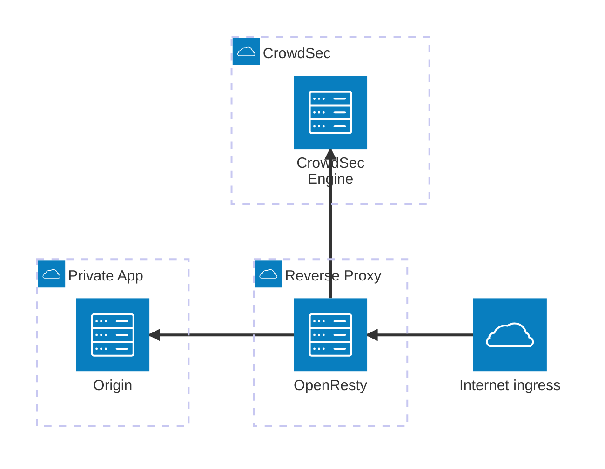

# Reverse Proxy with CrowdSec

This example shows how to setup an OpenResty reverse proxy
for a private service. The reverse proxy is protected by
a private CrowdSec engine.

## Architecture

View architecture [diagram on mermaid.live](https://mermaid.live/edit#pako:eNpdkk9P4zAQxb-KNSeQksppEpL1AYk_e1hpV4sKJ0gPxhlSS41tje0upep3R02bLOVmP__e8zxpdqBsiyBAklrpgCpEwvQVg2wMY4x1ZKNjjvRGBkylcxdqbWN7-fJwlNiNc8uvqPIjcUf2X_uI6uyZcIPkMXVk37cjuTiK7OEgLhtzNHikjVbIyF0cjkiXL38dmgX6sF0ybc6zzj3K42Qa52A_TacNDlblz_lTwf8fke60GdAv3b9Ppk1AMhjGHr9Od6ZNR-j9VIWc-M3S9JotxClu0p8G_VYojyM9xk4eco2BBHqkXuoWBOwOYANhhT02IFgDLb7JuA4NNGYPCcgY7OPWKBCBIiZANnYrEG9y7TGB6FoZ8F7LjmQ_qU6aZ2v70eKkAbGDdxBVVs6uiqKo-Dwr6iKvE9iCyK_4jGdVXec551Wdzct9Ah9DAJ_VVck55_O8LMs8z7IEsNXB0p_jsg07l0BHhzanCdG0SHc2mgCi-MH3n--G3SM).

## Run

### Accounts

1. Create a [CrowdSec account](https://app.crowdsec.net/) and get your enrollment key from the Console
2. Create a [Pulumi Cloud account](https://app.pulumi.com/) or use a self-managed backend
3. Create a [Fly.io account](https://fly.io/dashboard/) and get the org slug

### Deploy

1. Create a new Pulumi stack
2. Set your CrowdSec enrollment key as a stack secret: `pulumi config set --secret crowdSecEnrollKey`
3. Set the Fly.io org slug as a plaintext config: `pulumi config set flyOrgSlug`
4. Run `pulumi up`

### Post Deployment

Go to the CrowdSec console and accept the enroll request.
Wait for a few minutes for the CrowdSec engine to sync
rules and to show that the remediation component is online.
A log processor will also show as online after the sync.
